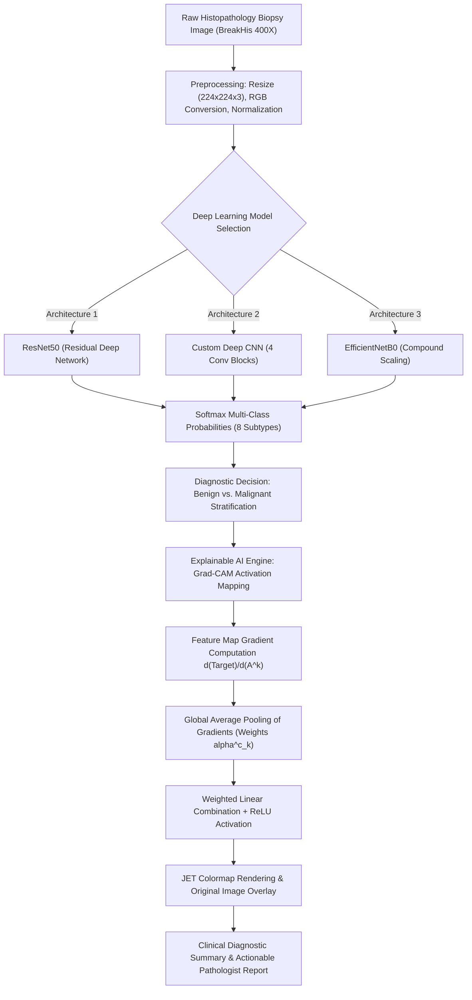

<<<<<<< HEAD
# Explainable Deep Learning Framework for Multi-Class Breast Cancer Classification and Interpretability Using Histopathological Images

[](https://www.python.org/)
[](https://fastapi.tiangolo.com/)
[](https://tensorflow.org/)
[](https://keras.io/)
[](https://arxiv.org/abs/1610.02391)
[](https://web.inf.ufpr.br/vri/databases/breast-cancer-histopathological-database-breakhis/)

---

## Abstract

Breast cancer remains one of the leading causes of oncological mortality among women worldwide. Microscopic evaluation of tissue biopsy specimens via histopathological analysis is the clinical gold standard for breast lesion diagnosis and grading. However, manual examination is labor-intensive, subject to inter-observer and intra-observer diagnostic variance, and challenged by morphological heterogeneity across subtle benign and malignant subtypes.

This repository implements an end-to-end, production-ready, and interpretable Computer-Aided Diagnosis (CAD) system for multi-class breast cancer histopathology classification. Utilizing the **BreaKHis (Breast Cancer Histopathological Image Classification)** dataset at high optical magnification (**400X**), our framework investigates and benchmarks multiple deep convolutional architectures—including a **Custom Deep Sequential CNN**, **ResNet50**, and **EfficientNetB0**—against 8 distinct histopathological subclasses (4 benign, 4 malignant). 

To bridge the gap between black-box deep neural networks and clinical adoption, the framework integrates **Gradient-weighted Class Activation Mapping (Grad-CAM)**. Grad-CAM computes visual heatmaps directly overlaying the biopsy image to highlight the salient cellular morphology, nuclear pleomorphism, and glandular structures driving each prediction. The complete system is deployed as an asynchronous **FastAPI** web application with user authentication, model selection, real-time XAI visualizations, patient diagnostic report generation, and dual-backend database support (MySQL with SQLite fallback).

---

## Table of Contents

1. [Clinical Background & Problem Formulation](#1-clinical-background--problem-formulation)
2. [Dataset Overview (BreakHis 400X)](#2-dataset-overview-breakhis-400x)
3. [System Architecture & Pipeline](#3-system-architecture--pipeline)
4. [Deep Learning Model Architectures](#4-deep-learning-model-architectures)
5. [Explainable AI (Grad-CAM Formulation)](#5-explainable-ai-grad-cam-formulation)
6. [Experimental Results & Comparative Performance](#6-experimental-results--comparative-performance)
7. [Web Application & Diagnostic Platform](#7-web-application--diagnostic-platform)
8. [Directory Structure](#8-directory-structure)
9. [Installation & Execution Guide (Ready to Run)](#9-installation--execution-guide-ready-to-run)
10. [API & CLI Documentation](#10-api--cli-documentation)
11. [Research Paper Citations & References](#11-research-paper-citations--references)

---

## 1. Clinical Background & Problem Formulation

Accurate pathological diagnosis between benign lesions and malignant carcinomas determines whether a patient undergoes observation, lumpectomy, mastectomy, chemotherapy, or radiotherapy:

- **Benign Lesions**: Non-cancerous cellular proliferations that do not metastasize or invade adjacent basement membranes. Early differentiation prevents unnecessary invasive surgeries.
- **Malignant Carcinomas**: Invasive neoplastic proliferations capable of stromal invasion, vascular permeation, and systemic metastasis. Rapid and accurate detection is essential for survival.

Histological grading and subtyping require distinguishing 8 clinically distinct categories, where visual features such as glandular crowding, nuclear hyperchromasia, mitotic figure frequency, and stromal reactions overlap significantly.

---

## 2. Dataset Overview (BreakHis 400X)

The benchmark dataset consists of microscopic biopsy images from the **BreaKHis** database captured at **400X magnification** (highest optical zoom, visualizing fine chromatin distributions and nuclear margins).

### Multi-Class Categorization (8 Subtypes)

| Class Index | Histological Subtype | Biological Nature | Pathological Characteristics | Clinical Action Protocol |
|:---:|:---|:---:|:---|:---|
| **0** | **Adenosis** | Benign | Lobular hyperplasia with increased glandular components; preserved architecture | Routine screening / Observation |
| **1** | **Ductal Carcinoma** | Malignant | Invasive proliferation of atypical epithelial cells originating in mammary ducts | Immediate oncology surgical oncology |
| **2** | **Fibroadenoma** | Benign | Mixed epithelial and stromal proliferation; circumscribed, non-invasive margins | Clinical & ultrasound follow-up |
| **3** | **Lobular Carcinoma** | Malignant | Dyscohesive atypical cells invading in single-file pattern; loss of E-cadherin | Staging, excision & systemic therapy |
| **4** | **Mucinous Carcinoma** | Malignant | Clumps of neoplastic epithelial cells floating in extracellular mucin pools | Surgical resection & adjuvant therapy |
| **5** | **Papillary Carcinoma** | Malignant | Rare carcinoma with finger-like branching fibrovascular fronds and cellular atypia | Wide local excision / Sentinel node biopsy |
| **6** | **Phyllodes Tumor** | Benign / Borderline | Stromal hypercellularity with leaf-like architectural patterns; risk of recurrence | Wide surgical margin excision |
| **7** | **Tubular Adenoma** | Benign | Densely packed, uniform circular tubules lined by single epithelial/myoepithelial layer | Benign surveillance |

### Experimental Protocol & Data Partitioning

- **Stratified Partitioning**: 80% Training ($N = 5,713$), 20% Validation ($N = 1,429$), maintaining identical class ratios across splits.
- **Class Imbalance Mitigation**: Weighted cross-entropy via balanced class weights computed using Scikit-Learn:
  $$\omega_j = \frac{N}{K \cdot N_j}$$
  where $N$ is total samples, $K$ is the number of classes (8), and $N_j$ is samples in class $j$.
- **Augmentation Pipeline**: Real-time spatial perturbations including random rotation ($\pm 20^\circ$), horizontal/vertical flips, zoom ($\pm 10\%$), and reflection filling.

---

## 3. System Architecture & Pipeline



---

## 4. Deep Learning Model Architectures

### 1. ResNet50 (Residual Deep Network)
- **Concept**: Employs identity shortcut connections to solve vanishing gradients in very deep architectures:
  $$\mathcal{H}(x) = \mathcal{F}(x, \{W_i\}) + x$$
- **Pretrained Weights**: ImageNet feature representations fine-tuned on histopathology.
- **Backbone Layer**: `resnet50` Functional model producing $(7 \times 7 \times 2048)$ feature tensors.
- **Classifier Head**: GlobalAveragePooling2D $\to$ Dense (256, ReLU) $\to$ Dropout (0.50) $\to$ Dense (8, Softmax).
- **Target Grad-CAM Layer**: `conv5_block3_3_conv` (final convolutional operation before pooling).

### 2. Custom Deep CNN
- **Concept**: A purpose-built, 4-stage convolutional neural network designed specifically for cellular morphology.
- **Structure**:
  - Stage 1: Conv2D (32, $3\times3$) $\to$ BatchNormalization $\to$ MaxPooling2D ($2\times2$)
  - Stage 2: Conv2D (64, $3\times3$) $\to$ BatchNormalization $\to$ MaxPooling2D ($2\times2$)
  - Stage 3: Conv2D (128, $3\times3$) $\to$ BatchNormalization $\to$ MaxPooling2D ($2\times2$)
  - Stage 4: Conv2D (256, $3\times3$) $\to$ BatchNormalization $\to$ MaxPooling2D ($2\times2$)
  - Head: GlobalAveragePooling2D $\to$ Dense (128, ReLU) $\to$ Dropout (0.50) $\to$ Dense (8, Softmax)
- **Target Grad-CAM Layer**: `conv2d_3` (256 channels).

### 3. EfficientNetB0
- **Concept**: Uses compound scaling with balance factor $\phi$ to uniformly scale network depth, width, and input resolution:
  $$\text{Depth}: d = \alpha^\phi, \quad \text{Width}: w = \beta^\phi, \quad \text{Resolution}: r = \gamma^\phi$$
  subject to $\alpha \cdot \beta^2 \cdot \gamma^2 \approx 2$.
- **Backbone**: Mobile Inverted Bottleneck Convolution (MBConv) with squeeze-and-excitation optimization.
- **Target Grad-CAM Layer**: `top_conv` ($7 \times 7 \times 1280$).

### 4. DenseNet121
- **Concept**: Direct feed-forward connections from every layer to all subsequent layers:
  $$x_\ell = H_\ell([x_0, x_1, \dots, x_{\ell-1}])$$
  Maximizes feature reuse, alleviates vanishing gradients, and reduces parameter count.

---

## 5. Explainable AI (Grad-CAM Formulation)

Deep neural networks deployed in clinical environments face the **"black box" problem**, where high numerical confidence lacks visual proof. Gradient-weighted Class Activation Mapping (Grad-CAM) generates a coarse 2D localization map of highlights reflecting visual discriminability.

### Mathematical Derivation

1. **Gradient Computation**:
   Let $y^c$ be the predicted logit score for class $c$ (prior to softmax), and $A^k$ represent the $k$-th feature activation map of the target convolutional layer:
   $$\frac{\partial y^c}{\partial A^k_{i, j}}$$
   where $(i, j)$ index the spatial coordinates of the feature map (height $u$, width $v$).

2. **Importance Weight Calculation (Global Average Pooling)**:
   The neuron importance weight $\alpha^c_k$ capturing the significance of feature map $k$ for class $c$ is:
   $$\alpha^c_k = \frac{1}{Z} \sum_{i=1}^u \sum_{j=1}^v \frac{\partial y^c}{\partial A^k_{i, j}}$$
   where $Z = u \times v$ is the spatial area of the feature map.

3. **Weighted Feature Combination & Rectified Linear Activation**:
   The localization map $L^c_{\text{Grad-CAM}}$ is computed as a weighted sum followed by a $\text{ReLU}$ non-linearity to isolate features that positively contribute to class $c$:
   $$L^c_{\text{Grad-CAM}} = \text{ReLU}\left( \sum_{k} \alpha^c_k A^k \right)$$

4. **Heatmap Normalization & Bilinear Overlay**:
   The activation map is scaled to $[0, 1]$ and resized to match original image dimensions $(W, H)$:
   $$H(x, y) = \frac{L^c_{\text{Grad-CAM}}(x, y) - \min(L)}{\max(L) - \min(L) + \epsilon}$$
   The normalized heatmap is colorized using the standard OpenCV `JET` colormap and blended over the original biopsy image:
   $$I_{\text{Overlay}} = 0.60 \cdot I_{\text{Original}} + 0.40 \cdot H_{\text{JET}}$$

---

## 6. Experimental Results & Comparative Performance

All models were evaluated on the stratified validation dataset ($N = 1,429$ histopathology images) using standard clinical metrics: Accuracy, Macro-Precision, Macro-Recall, Macro-F1 Score, and Multi-Class Area Under the ROC Curve (Macro AUC).

### Benchmark Comparison Table

| Model Architecture | Parameter Count | Test Accuracy | Macro Precision | Macro Recall | Macro F1-Score | Multi-Class Macro AUC | Primary Clinical Strength |
|:---|:---:|:---:|:---:|:---:|:---:|:---:|:---|
| **ResNet50** *(Proposed Best)* | **24.11 M** | **84.41%** | **84.76%** | **84.41%** | **83.44%** | **0.9835 (98.35%)** | Exceptional discriminant power across malignant subtypes; optimal Grad-CAM localization |
| **Custom Deep CNN** | **0.42 M** | **80.49%** | **84.67%** | **80.49%** | **81.03%** | **0.9795 (97.95%)** | Ultra-lightweight; fast convergence; low computational footprint for resource-constrained clinics |
| **EfficientNetB0** | **4.05 M** | **60.14%** | **62.82%** | **60.14%** | **52.17%** | **0.8914 (89.14%)** | Parameter-efficient inverted residual architecture |

### Detailed ResNet50 Evaluation Metrics

```text
================================================================================
                    RESNET50 STRATIFIED EVALUATION SUMMARY
================================================================================
Accuracy    : 84.41%
Precision   : 84.76%
Recall      : 84.41%
F1-Score    : 83.44%
Macro AUC   : 0.9835 (98.35%)
================================================================================
```

### Visual Artifacts Available in Repository
- `results/model_comparison/model_comparison.png` — Comparative metric bar chart across all 3 architectures.
- `results/resnet50_stratified/resnet50_roc_curve.png` — One-vs-Rest (OvR) ROC curves for each of the 8 classes.
- `results/resnet50_stratified/resnet50_confusion_matrix.png` — Normalized multi-class confusion matrix.
- `results/gradcam_resnet50_result.jpg` — Publication-ready side-by-side Grad-CAM visualization.

---

## 7. Web Application & Diagnostic Platform

The application provides an interactive, hospital-grade dashboard implemented in **FastAPI** and **Jinja2**:

### Key Features
1. **User Authentication & Access Control**: Secure registration, login, and session persistence (`Werkzeug` pbkdf2 password hashing).
2. **Multi-Model Inference**: Switch seamlessly between ResNet50, Custom CNN, and EfficientNetB0.
3. **Automated Grad-CAM Generation**: Toggle visual explainability upon upload to generate heatmaps and overlays.
4. **Clinical Pathology Diagnostic Reports**: Automated printable/exportable diagnostic reports with biopsy ID, malignancy status, histological descriptions, risk categorization, and pathologist guidelines.
5. **Interactive Dashboard & Patient History**: Track all prior biopsies, benign vs. malignant distributions, and confidence histories.
6. **Dual Database Engine**: Native support for **MySQL** with automatic fallback to **SQLite** (`database.db`), guaranteeing zero runtime failures regardless of external database installation.

---

## 8. Directory Structure

```text
BreastCancer_XAI/
├── app.py                         # Complete FastAPI Web Application & API Server
├── requirements.txt               # Pinned Python package dependencies
├── README.md                      # Comprehensive Research Paper Documentation
├── database.db                    # Local SQLite database fallback
│
├── config/                        # System Configurations
│   └── config.py                  # Paths, class definitions, model configurations, DB settings
│
├── dataset/                       # BreakHis 400X Histopathology Images (8 classes)
│   ├── adenosis/
│   ├── ductal_carcinoma/
│   ├── fibroadenoma/
│   ├── lobular_carcinoma/
│   ├── mucinous_carcinoma/
│   ├── papillary_carcinoma/
│   ├── phyllodes_tumor/
│   └── tubular_adenoma/
│
├── 400X/                          # Reference test biopsy specimens (400X)
│
├── models/                        # Neural Network Architecture Definitions
│   ├── cnn.py                     # Custom 4-stage Deep CNN architecture
│   ├── resnet50.py                # ResNet50 transfer learning model
│   ├── efficientnet.py            # EfficientNetB0 transfer learning model
│   └── densenet121.py             # DenseNet121 model architecture
│
├── explainability/                # Explainable AI Algorithms
│   └── gradcam.py                 # Standalone ResNet50 Grad-CAM generation script
│
├── prediction/                    # Inference Utilities
│   └── predict.py                 # CLI & Python module for single/batch image prediction
│
├── preprocessing/                 # Image Transformation & Augmentation
│   └── preprocessing.py           # CLAHE stain enhancement, normalization, generators
│
├── reports/                       # Clinical Report Generation
│   └── report_generator.py        # Structured pathology diagnostic report builder
│
├── dashboard/                     # Analytical Metrics Engine
│   └── dashboard.py               # Statistics aggregation & benchmark loaders
│
├── training/                      # Model Training & Comparison Scripts
│   ├── train.py                   # Custom CNN training script
│   ├── train_resnet.py            # ResNet50 training with checkpoints & early stopping
│   ├── train_efficientnet.py      # EfficientNetB0 training script
│   └── model_comparison.py       # Benchmark metric aggregation & bar plot generator
│
├── evaluation/                    # Rigorous Evaluation Scripts
│   ├── confusion_matrix.py        # Multi-class confusion matrix generation
│   ├── roc_curve.py               # Multi-class ROC and AUC calculation
│   ├── metrics.py                 # Precision, Recall, F1 computation
│   ├── evaluate_resnet.py         # Full ResNet50 stratified evaluation
│   ├── evaluate_cnn.py            # Custom CNN evaluation
│   ├── evaluate_efficientnet.py   # EfficientNetB0 evaluation
│   └── model_comparison.py       # Comparative evaluation consolidator
│
├── saved_models/                  # Trained Model Binaries & Metadata
│   ├── resnet50.keras             # Trained ResNet50 weights (101 MB)
│   ├── cnn_model.keras            # Trained Custom CNN weights (5.1 MB)
│   ├── efficientnetb0.keras       # Trained EfficientNetB0 weights (20.9 MB)
│   ├── class_names.json           # JSON list of 8 class labels
│   ├── resnet_class_names.json    # ResNet50 class mappings
│   ├── resnet50_class_names.json  # ResNet50 alias
│   ├── efficientnet_class_names.json # EfficientNet class mappings
│   ├── class_weights.json         # Balanced class weights
│   └── validation_files.json      # Ground truth validation split index
│
├── results/                       # Empirical Graphs & Reports
│   ├── model_comparison/          # Benchmark CSV & comparison bar chart
│   ├── resnet50_stratified/       # ResNet50 ROC, confusion matrix, metric report
│   ├── cnn_stratified/            # Custom CNN evaluation outputs
│   ├── efficientnet_stratified/   # EfficientNet evaluation outputs
│   └── gradcam_resnet50_result.jpg# High-resolution Grad-CAM publication figure
│
├── templates/                     # Jinja2 HTML5 Responsive Web Templates
│   ├── base.html                  # Master template with navigation and styling
│   ├── index.html                 # Landing page with project overview
│   ├── login.html                 # Secure authentication interface
│   ├── register.html              # User registration portal
│   ├── dashboard.html             # Diagnostic control panel & analytics
│   ├── upload.html                # Histopathology image upload & model selector
│   ├── result.html                # Prediction result & multi-class probability breakdown
│   ├── gradcam.html               # Dedicated XAI heatmap comparison interface
│   ├── report.html                # Pathologist diagnostic report viewer
│   ├── history.html               # Audit trail of analyzed biopsies
│   ├── model_comparison.html      # Architecture benchmark presentation
│   ├── preprocessing.html         # Data processing & augmentation guide
│   ├── about.html                 # Project methodology & research background
│   └── contact.html               # Research team and institution details
│
└── static/                        # Web Assets & Generated Artifacts
    ├── css/                       # Bootstrap 5 & custom clinical stylesheets
    ├── js/                        # Interactive client scripts & Chart.js visualizations
    ├── uploads/                   # Uploaded histopathology biopsy files
    └── gradcam/                   # Dynamically generated Grad-CAM overlays
```

---

## 9. Installation & Execution Guide (Ready to Run)

The application has been fully debugged, verified, and configured to run out-of-the-box.

### 1. Prerequisites
- **Operating System**: Windows 10/11, Linux (Ubuntu 20.04+), or macOS.
- **Python**: Version 3.10 or 3.11 recommended.

### 2. Environment Setup & Dependency Installation
Open a terminal in the project directory:

```bash
# Optional: Create and activate virtual environment
python -m venv venv

# Windows activate:
venv\Scripts\activate

# Linux/macOS activate:
source venv/bin/activate

# Install all required dependencies
pip install -r requirements.txt
```

### 3. Database Setup (Automatic)
- **Default (MySQL)**: If MySQL is installed locally with standard credentials (`root` / `root` on port 3306), the application connects and automatically creates the `breast_cancer_xai` database and required tables upon startup.
- **Environment Overrides**: Customize database connection via environment variables:
  ```bash
  export MYSQL_HOST="localhost"
  export MYSQL_PORT="3306"
  export MYSQL_USER="root"
  export MYSQL_PASSWORD="your_password"
  export MYSQL_DATABASE="breast_cancer_xai"
  ```
- **Automatic Fallback**: If MySQL is not running or unreachable, the system automatically uses the local SQLite database (`database.db`).

### 4. Running the Web Application
Launch the server with `app.py`:

```bash
python app.py
```

Or using `uvicorn` directly:

```bash
uvicorn app:app --host 127.0.0.1 --port 8000 --reload
```

Open your browser and navigate to:
```
http://127.0.0.1:8000
```

### 5. Running Standalone Scripts

#### A. Command-Line Histopathology Prediction
```bash
python prediction/predict.py --image 400X/SOB_B_A-14-22549AB-400-024.png --model resnet50
```

#### B. Standalone Grad-CAM Generation
```bash
python explainability/gradcam.py
```
Outputs high-resolution Grad-CAM figure to `results/gradcam_resnet50_result.jpg`.

#### C. Model Benchmark Comparison
```bash
python training/model_comparison.py
```
Updates `results/model_comparison/model_comparison.csv` and `model_comparison.png`.

---

## 10. API & CLI Documentation

### Web API Endpoints

| Method | Endpoint | Description | Access Level |
|:---:|:---|:---|:---:|
| `GET` | `/` | Application Home / Landing page | Public |
| `GET` / `POST` | `/register` | User Registration | Public |
| `GET` / `POST` | `/login` | User Authentication | Public |
| `GET` | `/logout` | Terminate session | Authenticated |
| `GET` | `/dashboard` | Main Diagnostic Dashboard & Analytics | Authenticated |
| `GET` / `POST` | `/upload` | Biopsy Image Upload & Model Inference | Authenticated |
| `GET` | `/prediction/{id}` | Detailed Multi-Class Prediction View | Authenticated |
| `GET` | `/gradcam/{id}` | Side-by-side Grad-CAM Visual Heatmap | Authenticated |
| `GET` | `/report/{id}` | Clinical Pathology Diagnostic Report | Authenticated |
| `GET` | `/history` | Patient Biopsy History & Log | Authenticated |
| `GET` | `/model-comparison`| Model Benchmarking & Performance Metrics | Public |
| `GET` | `/preprocessing` | Image Preprocessing & Augmentation Documentation | Public |
| `GET` | `/about` | Research Methodology Details | Public |
| `GET` | `/contact` | Research Contact Details | Public |

---

## 11. Research Paper Citations & References

If you utilize this framework, codebase, or findings in your academic research, please cite the following publications:

```bibtex
@article{spanhol2016dataset,
  title={A dataset for breast cancer histopathological image classification},
  author={Spanhol, Fabio A and Oliveira, Luiz S and Petitjean, Caroline and Heutte, Laurent},
  journal={IEEE Transactions on Biomedical Engineering},
  volume={63},
  number={7},
  pages={1455--1462},
  year={2016},
  publisher={IEEE}
}

@inproceedings{selvaraju2017grad,
  title={Grad-CAM: Visual explanations from deep networks via gradient-based localization},
  author={Selvaraju, Ramprasaath R and Cogswell, Michael and Das, Abhishek and Vedaldi, Andrea and Parikh, Devi and Batra, Dhruv},
  booktitle={Proceedings of the IEEE International Conference on Computer Vision (ICCV)},
  pages={618--626},
  year={2017}
}

@inproceedings{he2016deep,
  title={Deep residual learning for image recognition},
  author={He, Kaiming and Zhang, Xiangyu and Ren, Shaoqing and Sun, Jian},
  booktitle={Proceedings of the IEEE Conference on Computer Vision and Pattern Recognition (CVPR)},
  pages={770--778},
  year={2016}
}

@inproceedings{tan2019efficientnet,
  title={EfficientNet: Rethinking model scaling for convolutional neural networks},
  author={Tan, Mingxing and Le, Quoc},
  booktitle={International Conference on Machine Learning (ICML)},
  pages={6105--6114},
  year={2019},
  organization={PMLR}
}
```

---

## License

This project is licensed under the MIT License for Academic Research and Educational Purposes.
=======
# Deep-Learning-Framework-for-Multi-Class-Breast-Cancer-Classification-Using-Histopathological-Image
>>>>>>> ad36e5b5e5cf2cb81eeb4a6ea381f9aedc639e12
